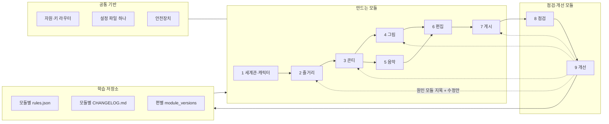

# Tailored 자동 제작 엔진 모듈 구조 v0 (2026-11-23, 캐스토 초안 — 설계만, 코드 변경 없음)

목표: 대사 없는 동물 연재 만화 쇼츠를 주 1편, 편당 약 11크레딧·사람 시간 5분 안에 만들고, 편마다 「어느 모듈의 어느 버전이 만들었는지」를 남겨 성과가 나쁜 모듈만 골라 고친다.
견본: `Scripto/docs/engine_modules_v0.md`(글쓰기 8모듈)를 영상 제작에 맞게 바꿨다. 적용은 사용자 승인 뒤.

## 구조도

## 모듈 9 + 공통 기반 3

### 만드는 모듈 (1~7)

| # | 모듈 | 하는 일 | 입력 → 출력 | 지금 담당하는 실제 파일 | 성장 지표 |
|---|---|---|---|---|---|
| 1 | 세계관·캐릭터 | 캐릭터가 나오기 전에 설정을 채우고 충돌을 막는다 | 시즌 계획·사용자 설정 → 확정 캐릭터 카드, 세계 법칙, 기준 그림, 소지품 장부 | `tailored/characters.json` `world.json` `inventions.json` `continuity.json`, `tailored_cast.py`(lint·check·prompt·page) | 그림 생성 전 충돌 0건 유지, 캐릭터 규칙 위반으로 다시 그린 컷 수 |
| 2 | 줄거리 | 한 화의 이야기를 컷 단위 뼈대로 쓴다 | 시즌 아크·지금까지 줄거리·장부 → 비트 시트(약 27컷, 콜드 오픈, 클리프) | `tailored/seasons/s1.json` `story_so_far.md` `episodes/<화>/beats.md` — 세션(Claude)이 작성 | 사용자 수정 요청 횟수, 평균 시청 지속률, 다음 화 이어보기 |
| 3 | 콘티 | 비트를 화면 지시로 바꾼다 | 비트 시트 → `conti.json`(컷별 장면·등장 캐릭터·카메라·길이·자막 4개 언어·실험 변수) | `episodes/<화>/conti.json` — 세션이 작성 | 첫 3초 유지율, 컷당 길이 대비 이탈, 자막 길이 초과 0 |
| 4 | 그림 | 컷 그림과 엔딩 영상을 만든다 | 콘티 + 기준 그림 → 컷 이미지 26~28장, 엔딩 영상 4초 | 힉스필드(세션 도구, 코드 없음), `tailored_cast.py prompt`, `tailored/tests/consistency_2_5/` | 다시 그리기 비율(3화 12%), 편당 크레딧(3화 8.75), 규칙 위반 컷 |
| 5 | 음악 | 편마다 로파이 한 곡을 만든다 | 콘티의 음악 지시문 → mp3(약 72초) | `bgm.py`, `assets/bgm/` | 생성 실패율, 월 사용 분(ElevenLabs 한도 대비) |
| 6 | 편집 | 그림·영상·음악을 한 편으로 묶고 자막 파일을 만든다 | 콘티 + 그림 + 음악 → mp4(1080×1920), SRT 4개 | `tailored_render.py` `tailored_captions.py` `clay_stop.py` `.github/workflows/clay-stop.yml` `pilot/stop/request.txt` | 렌더 성공률(지금 4/4), 렌더 시간(약 6분), 편집 때문에 다시 만든 횟수 |
| 7 | 게시 | 유튜브에 올리고 자막·다국어 제목을 붙인다 | mp4 + SRT + 제목 → 공개 쇼츠 | 수동(크롬 유튜브 스튜디오). 옛 채널용 `publish.py` `yt_auth.py`는 이 채널 인증 없음 | 게시에 든 사람 시간(지금 약 15분), 자막·제목 누락 0, 예정일 게시율 |

### 점검·개선 모듈 (8~9)

| # | 모듈 | 하는 일 | 입력 → 출력 | 지금 담당하는 실제 파일 | 성장 지표 |
|---|---|---|---|---|---|
| 8 | 점검 | 게시한 편의 성과를 모은다 | 공개 영상 → 노출수·노출 클릭률·평균 시청 지속률·조회수(24시간, 7일) | 자동: `channel_stats.py`(구독·조회·좋아요만, 매일) / 수동: `tailored/experiments.md`(스튜디오 수치를 크롬으로 읽어 기록) | 24시간·7일 기록을 제때 채운 비율, 수집 성공률 |
| 9 | 개선 | 성과가 낮은 원인 모듈을 지목하고 수정안을 낸다 | 점검 기록 + 편별 모듈 버전 → 「모듈·버전·수정안·다음 편 실험 변수」 | 지금 수동: `experiments.md`의 읽는 법, 스킬 `video-variable-test` | 수정 전후 성과 차이, 실험으로 승격·기각된 규칙 수 |

개선 모듈이 원인을 지목하는 기준(지금 쓰는 읽는 법을 그대로 옮김):

| 관찰 | 지목하는 모듈 | 수정안의 종류 |
|---|---|---|
| 노출수가 거의 없음 | 7 게시, 2 줄거리 | 올리는 시각·제목 형식, 주제·소재 |
| 노출은 있는데 넘기지 않고 본 비율이 낮음 | 3 콘티 | 첫 3초(콜드 오픈) |
| 끝까지 본 비율이 낮음 | 3 콘티, 2 줄거리 | 길이·컷 속도, 방해·반전 배치 |
| 다시 그리기·크레딧이 늘어남 | 4 그림, 1 세계관·캐릭터 | 지시문 규칙, 기준 그림 보강 |

### 공통 기반 (모듈 밖)

| 기반 | 하는 일 | 지금 있는 것 | 비어 있는 것 | 지표 |
|---|---|---|---|---|
| 자원·키 라우터 | 싼 자원을 먼저 쓰고, 한도가 차거나 단가가 바뀌면 전환·정지 | 글: `common.py llm()`(무료 키 우선, 한도 소진 시 전환) / 그림: 생성 전 견적 + 보드 `budget/` 장부 예약(세션 규칙) / 음악: `bgm.py`(같은 이름이면 재사용) | 그림 모델 우선순위가 코드가 아니라 규칙 문장으로만 있음 | 편당 크레딧, 견적과 실차감 일치율, 호출 실패율 |
| 설정 파일 하나 | 컷 수·길이·언어·모델·게시 요일을 한 곳에서 바꾼다 | `tailored/world.json`의 format, `casto.json`(옛 파이프라인), 콘티마다 반복되는 값 | 한 파일로 모으기(제안: `tailored/engine.config.json`) | — |
| 안전장치 | 미리보기·백업·사용자 승인 | 미리보기: 텔레그램 초안 + 채팅 / 백업: git 커밋 / 승인: 보드 판단 카드, 게시 버튼 직전 확인 / 차단: `tailored_cast.py check`(등장 준비 안 되면 그림 생성 금지), 장부 예약 | 게시 뒤 되돌림 절차(비공개 전환) 문서화 | 승인 없이 나간 게시 0, 되돌림 횟수 |

## 성장 구조 (기록 → 비교 → 승격)

1. **코드는 고정, 규칙만 바꾼다.** 모듈마다 `tailored/modules/<이름>/rules.json`(지시문·기준값)과 `CHANGELOG.md`(버전·바꾼 이유·근거 데이터)를 둔다.

| 모듈 | rules.json에 들어갈 것(지금 값) |
|---|---|
| 줄거리 | 구성(훅 → 목표 하나·방해 둘 → 반전 → 클리프), 화당 발명품 1~2개, 냄새 법칙 같은 반복 장치 |
| 콘티 | 컷 24~28, 60~70초, 콜드 오픈 사용, 자막 한 줄 길이 상한, 언어 4개 |
| 그림 | 화풍 문장, 모델(GPT Image 2.5 low·1k), 참조 3장 규칙, 뒷모습·키 문구, 다시 그리기 한도 5컷 |
| 음악 | 지시문 틀(로파이, 80~84 BPM, 마지막 10~15초 분위기 전환), 길이 72초 |
| 편집 | 30fps, 카메라 기본 이동, 마지막 컷 영상 4초 |
| 게시 | 제목 형식, 올리는 요일·시각, 다국어 제목·자막 4개 |
| 점검 | 측정 시점(24시간, 7일), 기록 항목 4개 |
| 개선 | 위 「지목 기준」 표의 임계값, 승격 조건 |

2. **산출물마다 모듈 버전을 남긴다.** `conti.json`과 `experiments.md`에 `module_versions`를 적는다. 지금까지를 소급하면:

| 편 | module_versions | 바뀐 점 |
|---|---|---|
| 1화 | story@1.0 conti@1.0 art@1.0 music@1.0 render@1.0 publish@1.0 | 기준 |
| 2화 | story@1.0 **conti@1.1** art@1.0 music@1.0 render@1.0 publish@1.0 | 콜드 오픈(첫 3초) |
| 3화 | story@1.0 conti@1.1 **art@1.1** music@1.0 render@1.0 publish@1.0 | 그림 모델 2.5, 캐릭터 점검기 통과 후 생성 |

3. **개선안은 일부에만 적용해 비교한 뒤 승격한다.** 주 1편이라 「절반에만 적용」이 안 되므로, 한 편에 변수 하나만 바꾸는 지금 규칙을 그대로 쓴다: 새 규칙을 2주(2편) 적용 → 직전 2편과 같은 지표로 비교 → 이기면 정식 버전으로 승격하고 CHANGELOG에 근거 숫자를 적는다. 지면 되돌리고 그 사실도 적는다.

4. **이용자가 생기면(나중).** 동의한 이용자에 한해 영상·줄거리 본문 없이 「모듈 버전·분야·성과 숫자」만 익명으로 모은다. 모으는 목적은 모델 학습이 아니라 규칙 파일 갱신이다.

## 범위 구분

| 구분 | 모듈 | 지금 상태 |
|---|---|---|
| 지금 바로 돌아감(코드) | 5 음악, 6 편집, 8 점검 중 공개 수치, 1의 점검기 | 요청 파일을 올리면 렌더·음악·텔레그램까지 자동. 채널 공개 수치는 매일 자동 수집 |
| 세션이 운전(Claude가 채팅에서) | 1 세계관·캐릭터 갱신, 2 줄거리, 3 콘티, 4 그림 | 규칙은 있으나 실행은 채팅에서. 그림은 힉스필드가 세션 도구로만 연결됨 |
| 사람 손이 남음 | 7 게시, 8 점검 중 스튜디오 수치, 9 개선, 모든 승인 | 채널 계정 크롬이 필요. 게시는 편당 약 15분 |
| 나중에 자동화 | 7 게시(이 채널 업로드 인증 뒤), 8 점검(유튜브 분석 API), 9 개선(자동 지목), 2·3의 예약 실행 | 인증·API가 먼저. 그림 자동화는 힉스필드를 코드에서 부를 방법이 확인돼야 가능 |

## 적용한다면의 순서(승인 뒤, 참고)

1. `module_versions` 표시부터(콘티·실험 기록에 한 줄 추가 — 코드 이동 없음).
2. 모듈별 `rules.json`·`CHANGELOG.md`를 만들고 지금 값을 옮겨 적기(1.0 기준선).
3. 설정 파일 하나로 모으기.
4. 게시·점검 자동화(인증 필요 — 사용자 손이 한 번 듦).

## 미확인·한계

- 주 1편이라 비교 표본이 작다. 2편 대 2편 비교는 방향만 알려 줄 뿐 확정 근거가 되기 어렵다.
- 1화 조회 2회로 아직 성과 데이터가 없다. 지표 임계값은 2화 수치가 나온 뒤 정한다.
- 힉스필드를 코드에서 직접 부를 수 있는지는 확인하지 않았다(지금은 세션 도구).
- `channel_stats.py`가 모으는 것은 구독·조회·좋아요·댓글뿐이고 노출·클릭률·시청 지속률은 없다.
